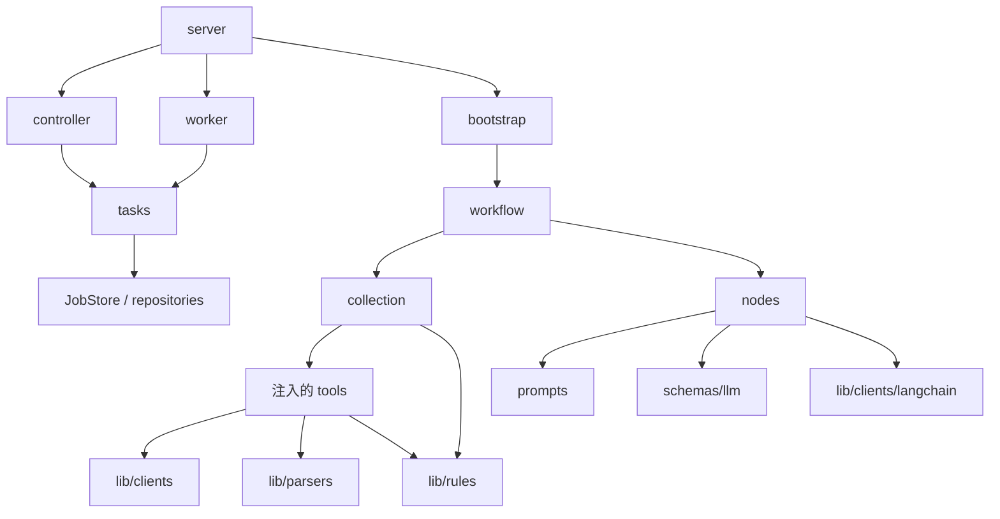

# 目前專案架構

本文件記錄目前實作。程式按**元件類型**分類，維持一個 Python 專案、一個套件；以組合注入依賴。
`nodes` 是固定流程中的分析操作，目前由普通 Python 函式執行，尚未導入 LangGraph。

功能報告：[Coverage](coverage-analysis.md)、[Existing Tests](existing-tests-analysis.md)。
工作進度與驗收：[Product Backlog](../BACKLOG.md)。本次重整：[遷移與驗證](structure-refactor.md)。

## 根目錄

```text
test_Agent/
├── AGENTS.md                    專案工作規則與 backlog 接續方式
├── BACKLOG.md                   PBI、順序、範圍、驗收與交付證據
├── pyproject.toml / uv.lock      單一 Python 套件與鎖定依賴
├── values.example.yaml          設定範本
├── values.yaml                  使用者設定與 secrets（不進 Git）
├── Dockerfile                   使用 uv 建置的非 root runtime image
├── deploy/                      本專案的 Compose 與 Traefik 路由
├── scripts/                     安裝、測試、smoke、啟動、部署的 shell 與操作入口
├── structure/                   實際架構、功能報告、部署說明與 artifact 契約
├── src/codebase_analysis/       Python 套件（詳見下方）
├── tests/                       行為、HTTP、儲存與依賴邊界測試
│   └── fixtures/                可提交的合成分析基準
└── .state/                      本機狀態與敏感實測基準（不進 Git）
```

## Python 套件

```text
src/codebase_analysis/
├── __init__.py                  公開 collector、agent、結果型別
├── server.py                    ASGI app 組裝、健康端點與 worker 生命週期
├── controller.py                HTTP 路由、認證、請求到任務的轉接
├── bootstrap.py                 組裝工具與模型；固定 build artifact URLs
├── settings.py                  values.yaml 載入、設定與 secret 驗證
├── interfaces.py                收集與分析所需的 Protocol
├── collection.py                非 LLM 資料收集、版本核對、方法上下文組裝
├── workflow.py                  收集 → 三個分析操作 → 引用驗證
├── tasks.py                     提交範圍檢查、領取任務、執行與保存結果
├── worker.py                    背景迴圈、啟停與單一 worker 鎖
├── smoke.py                     非 LLM 檢查流程及逐項結果
├── nodes/
│   ├── analysis.py              以共用 client 組合三個操作，符合 AnalysisModel 介面
│   ├── context.py               共用 PR 輸入裁切與截斷標示
│   ├── pr.py                    PR 摘要的輸入與模型結果轉換
│   ├── coverage.py              缺口候選排序、輸入與模型結果轉換
│   └── existing_tests.py        保留 dynamic 證據，為缺少 caller 者取得 LLM 推薦
├── prompts/
│   ├── common.py                共用 system 指示前綴
│   ├── pr.py                    PR 摘要提示
│   ├── coverage.py              缺口說明提示
│   └── existing_tests.py        測試推薦提示
├── tools/
│   ├── pull_request.py          PR／MR 擷取操作入口
│   ├── coverage.py              Coverage／metadata 下載、解析、XML digest 組合
│   ├── trace.py                 Trace 下載及解析入口
│   ├── source.py                固定來源 revision 的原始碼讀取入口
│   └── existing_tests.py        候選選擇、數量限制與內容讀取的協調
├── lib/
│   ├── errors.py                遠端整合錯誤
│   ├── clients/
│   │   ├── http.py              HTTP GET、逾時、redirect 與錯誤處理
│   │   ├── github.py            GitHub 認證、URL、分頁、tree／blob／source 讀取
│   │   ├── gitlab.py            GitLab 認證、URL、分頁、tree／raw file 讀取
│   │   ├── jenkins.py           Jenkins 認證與 artifact bytes 下載
│   │   └── langchain.py         泛用 structured model 呼叫與 schema 驗證
│   ├── parsers/
│   │   ├── pull_request.py      Code host 回應正規化
│   │   ├── coverage.py          JaCoCo／Cobertura XML 正規化
│   │   ├── metadata.py          Coverage metadata JSON 正規化
│   │   ├── trace.py             Per-test trace JSON 正規化
│   │   └── java.py              Java AST、方法、annotation 與宣告檔案上下文
│   └── rules/
│       ├── paths.py            Maven Java 來源與測試路徑分類
│       ├── selection.py        測試候選篩選與排序
│       ├── coverage.py         Diff 新增行與 coverage 交集
│       ├── provenance.py       Revision／coverage hash 核對
│       ├── context.py          缺口方法分組及 observed caller 對應
│       └── validation.py       模型輸出引用與證據驗證
├── models/
│   ├── pull_request.py         PR 與 ChangedFile
│   ├── coverage.py             Coverage、provenance、缺口與匹配結果
│   ├── source.py               SourceMethod、FocalMethod、TestContext、ExistingTest
│   ├── trace.py                TraceReport、TestInvocation、MethodReference
│   ├── analysis.py             AnalysisResult、LlmFindings、AgentResult
│   └── task.py                 BuildRequest 與 AnalysisJob
├── schemas/
│   ├── http.py                 HTTP request 驗證與 BuildRequest 轉換
│   ├── llm.py                  Structured output 契約
│   ├── metadata.py             Coverage metadata wire schema
│   └── trace.py                Java trace wire schema
└── repositories/
    ├── base.py                 JobStore Protocol
    └── sqlite.py               任務持久化、原子 claim、去重、retry
```

省略各 package 的 `__init__.py`。`models` 是程式內的 dataclass 資料；`schemas` 是外部邊界的 Pydantic 驗證契約。
檔案名稱如 `coverage.py` 表達它處理的資料，所在的類型目錄表達它的作用。

## 責任與依賴

- **Controller** 接受 HTTP 請求；不下載 artifact、不執行 SQL、不呼叫模型。
- **Client** 是本程式呼叫遠端服務的端點，處理對外協定；controller 與 client 的方向不同。
- **Tool** 組合 client、parser、rule 完成一次操作，回傳正規化資料。工具內沒有 API 分頁或 AST／XML 演算法。
- **Node** 建立模型需要的輸入、選用提示與 schema、轉換模型結果。它不做遠端 repo 擷取。
- **Workflow** 決定順序；**collection** 協調確定性證據收集。
- **Repository** 管理任務資料；**tasks** 管理任務範圍與執行；**worker** 管理執行生命週期。
- **Lib** 是同套件內可直接 import 的實作，不是獨立 repo 或 uv workspace。不能反向依賴 tools、nodes 或 controller。
- `models`、`lib/rules`、`collection`、`workflow`、`tasks` 不直接依賴 FastAPI、LangChain 或 Pydantic。



`bootstrap.py` 選擇 GitHub 或 GitLab，建立共用 API client，注入薄工具。
`CodebaseAnalysisAgent` 接受 collector 與符合 `AnalysisModel` 的物件；正式實作使用
`AnalysisNodes(LangChainClient(chat_model))`。測試仍可注入簡單替身，不需繼承框架類別。
依賴方向由 `tests/test_architecture.py` 檢查。

## 與架構圖的對應

| 原圖 | 目前執行位置 | 工作 |
| --- | --- | --- |
| 藍色 PR fetch tool | `tools/pull_request.py` → `lib/clients`、`lib/parsers` | 取得 metadata、diff、commit |
| 藍色 Coverage fetch tool | `tools/coverage.py` → Jenkins client、parsers | 下載 coverage 與 metadata |
| 藍色 Existing test retriever | `tools/existing_tests.py` → clients、selection rule | 擷取候選測試檔案 |
| 綠色 PR summary | `nodes/pr.py` + `prompts/pr.py` | LLM 摘要 |
| 綠色 Uncovered line | `nodes/coverage.py` + `prompts/coverage.py` | LLM 解釋收集到的缺口 |
| 綠色 Existing test | `nodes/existing_tests.py` + 對應 prompt | 保留觀測 caller；LLM 推薦其餘方法的測試上下文 |

Coverage 交集、Java 方法分組及 trace 對應由純程式計算。綠色操作使用這些證據做模型分析。
原圖的 Step 1 是流程階段；目前不以每個 Step 建立一個主要資料夾。

## 完整執行流程

```text
Jenkins → controller → AnalysisJobs.submit → SQLite
worker → AnalysisJobs.process_next
       → bootstrap.settings_for_build → build_agent
       → workflow.CodebaseAnalysisAgent.run
           → collection.CodebaseAnalysis.run
               PR / coverage / trace → 版本核對 → coverage 交集
               → 原始碼與測試讀取 → Java AST → 缺口方法與 observed callers
           → 核對提交的 PR head 與 build 身分
           → nodes.pr.summarize_pr
           → nodes.coverage.identify_uncovered_lines
           → nodes.existing_tests.select_existing_tests
           → rules.validation.validate_findings
       → SQLite 保存 AgentResult
```

三個操作依序使用同一份 `AnalysisResult`。本次未改變彼此的資料傳遞方式：
coverage node 目前不把 PR summary 當成輸入；這項品質改善留在 backlog。
無缺口時略過 coverage 模型呼叫；已有 dynamic caller 的方法不再要求 LLM 推薦。

## Smoke、設定與部署

`./scripts/smoke-test.sh <number>` 讀取 `values.yaml`，透過相同工具依序檢查
`pr_fetch`、`coverage_fetch`、`trace_fetch`／`trace_binding`、`coverage_binding`、
`existing_tests`、`coverage_match`、`java_context`，不初始化或呼叫模型。

結果逐項顯示 `PASS`／`WARN`／`FAIL`／`SKIP`。只有 PASS／WARN 時 exit code 0；
有 FAIL／SKIP 時為 1；參數或設定錯誤為 2。獨立檢查繼續執行，前置失敗時略過依賴項目。

- 手動 smoke 使用設定的 URLs；HTTP 任務由可信 Jenkins base URL 建立固定 build artifact URLs。
- 原始碼與測試取自 PR head；metadata／trace 必須與該 revision 和 coverage bytes 一致。
- Java trace producer 在 Jenkins agent／sandbox 執行；Python 容器只下載、解析、分析 artifacts。
- 部署檔留在本專案，共用 Traefik 的 `/test-agent` 路由。見 [controller 與部署](controller-deployment.md)。
- 本次重整沒有部署新容器，既有容器不會因本機檔案移動而自動更新。

安裝與操作見[根目錄 README](../README.md)。
