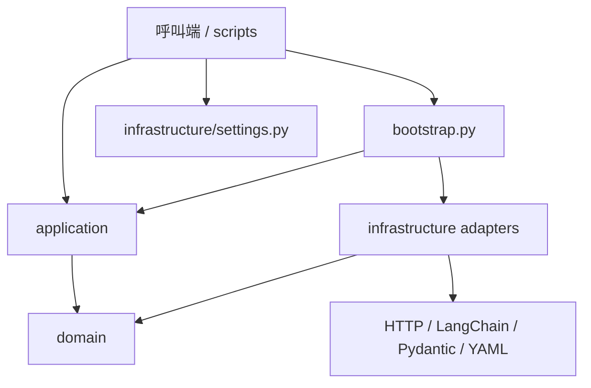
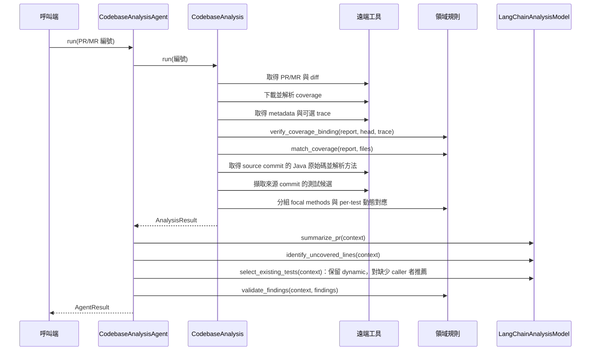

# 目前專案架構

本文件記錄目前程式的目錄、模組職責、組裝方式與執行流程。

功能設計與實作報告：[Coverage 缺口分析](coverage-analysis.md)、
[Existing Tests 上下文分析](existing-tests-analysis.md)。目標 repo 為 Java／Spring／Maven。

## 專案目錄

```text
test_Agent/
├── pyproject.toml                     Python 套件資訊、依賴與建置設定
├── uv.lock                            uv 鎖定的依賴版本
├── values.example.yaml                設定範本
├── values.yaml                        使用者設定與 secret，已排除版本控制
├── README.md                          安裝、設定與操作方式
├── structure/
│   ├── README.md                      目前專案架構
│   ├── coverage-analysis.md           Coverage 設計與實作報告
│   ├── existing-tests-analysis.md     Existing Tests 設計與實作報告
│   └── contracts/                     Jenkins coverage／trace schema 與 trace 合成範例
├── scripts/
│   ├── setup.sh                       安裝依賴、建立缺少的 values.yaml
│   ├── test.sh                        執行本機測試
│   ├── smoke-test.sh                  遠端 smoke test 的 shell 入口
│   └── smoke_test.py                  smoke test 參數、結果顯示與 exit code
├── src/
│   └── codebase_analysis/
│       ├── __init__.py                 匯出主要流程與結果型別
│       ├── bootstrap.py                組裝具體工具、collector 與模型
│       ├── domain/
│       │   ├── models.py               領域資料型別
│       │   ├── context.py              Java method、focal method、test context
│       │   ├── trace.py                Per-test 呼叫證據、版本與雜湊核對
│       │   ├── paths.py                Maven Java 來源分類
│       │   ├── coverage.py             coverage 與變更檔案、新增行比對
│       │   └── validation.py           驗證模型引用的行號與測試路徑
│       ├── application/
│       │   ├── ports.py                工具與模型的 Protocol 介面
│       │   ├── agent.py                資料收集與三個 LLM 操作的流程
│       │   └── smoke.py                非 LLM 遠端檢查流程
│       └── infrastructure/
│           ├── settings.py             YAML 讀取、設定驗證與 secret 型別
│           ├── http.py                 HTTP GET、逾時與重新導向處理
│           ├── errors.py               遠端整合錯誤型別
│           ├── code_hosts/
│           │   ├── api.py              GitHub／GitLab 認證、URL 與分頁
│           │   ├── pr_fetch.py         PR／MR metadata 與 diff 擷取
│           │   └── test_retriever.py   遠端來源 commit 的測試候選擷取
│           ├── coverage/
│           │   ├── jenkins.py          Jenkins artifact 下載
│           │   ├── metadata.py         Coverage 版本契約解析
│           │   └── xml.py              JaCoCo／Cobertura 正規化
│           ├── source/
│           │   ├── java.py             Java AST 解析
│           │   └── repository.py       Source commit 的原始碼擷取
│           ├── trace/
│           │   └── jenkins.py          Jenkins per-test trace 下載與 schema 驗證
│           └── llm/
│               └── langchain.py        三個 LLM 操作與結構化輸出
└── tests/
    ├── fakes.py                        HTTP 與資料來源替身
    ├── java_fixtures.py                Java source、XML 與 trace 合成資料
    ├── test_java_context.py            方法對應、trace、fallback 與證據驗證
    ├── test_java_integration.py        正式 adapters 的組裝整合測試
    ├── test_java_parser_process.py     大型 Java 行號與 native process 退出回歸測試
    ├── test_agent.py                   分析流程與引用驗證
    ├── test_architecture.py            核心層的 import 邊界
    ├── test_code_hosts.py              GitHub／GitLab 擷取
    ├── test_coverage.py                XML 正規化與 coverage 比對
    ├── test_coverage_metadata.py       Metadata 契約、版本與雜湊驗證
    ├── test_langchain_model.py         三個 LLM 操作的結構化輸出
    ├── test_settings.py                設定驗證、憑證與物件組裝
    └── test_smoke.py                   smoke 流程、失敗處理與 exit code
```

樹狀圖省略空白 `__init__.py`、IDE 設定與產生的快取／虛擬環境。

## 模組職責與依賴

| 模組 | 主要物件／函式 | 責任 |
| --- | --- | --- |
| `domain/models.py` | `PullRequest`、`CoverageReport`、`AnalysisResult`、`LlmFindings`、`AgentResult` | 定義工具與流程交換的不可變資料 |
| `domain/coverage.py` | `added_lines()`、`match_coverage()` | 解析 diff 新增行，以完整路徑或唯一後綴匹配 coverage |
| `domain/validation.py` | `validate_findings()` | 確認模型選取的行號、測試路徑存在於收集的候選 |
| `application/ports.py` | `PullRequestFetcher`、`CoverageSource`、`TestRetriever`、`AnalysisModel` | 定義應用流程依賴的介面 |
| `application/agent.py` | `CodebaseAnalysis` | 收集遠端資料、解析 Java 方法、核對 trace、建立動態測試上下文 |
| 同上 | `CodebaseAnalysisAgent` | 組合 collector 與模型，執行三個 LLM 操作及引用驗證 |
| `application/smoke.py` | `CollectionSmokeTest`、`SmokeCheck` | 逐項檢查遠端收集能力，保留各項成功、警告、失敗或略過結果 |
| `infrastructure/` | API client、retriever、parser、model adapter、settings | 處理外部服務、資料格式與套件整合 |
| `bootstrap.py` | `build_collector()`、`build_agent()` | 選擇具體實作並以建構子注入應用流程 |
| `scripts/smoke_test.py` | `main()` | 解析操作參數、呼叫組裝與檢查流程、格式化結果 |

以下箭頭代表程式依賴方向：



- `domain` 只依賴標準庫與自身。
- `application` 只依賴領域層與應用層自身，透過 Protocol 操作注入的物件。
- `infrastructure` 提供符合介面的實作；採用結構型別，不必繼承 Protocol。
- `bootstrap.py` 同時知道應用介面與具體實作，負責組裝。
- `scripts` 處理操作入口與顯示；收集、比對、檢查流程位於應用層及領域層。

核心層的 import 邊界由 `tests/test_architecture.py` 檢查。

## 實際物件組裝

`build_collector(settings)` 依 `code_host.provider` 建立：

| 應用介面 | GitHub 實作 | GitLab 實作 |
| --- | --- | --- |
| `PullRequestFetcher` | `GitHubPrFetcher` | `GitLabMrFetcher` |
| `TestRetriever` | `GitHubTestRetriever` | `GitLabTestRetriever` |
| `CoverageSource` | `JenkinsCoverage` | `JenkinsCoverage` |

上述物件共用 `HttpClient`，注入 `CodebaseAnalysis`。
PR 與測試擷取工具共用所選平台的 API client。

另外注入所選平台的 `SourceReader`、`JavaSourceAnalyzer`，以及有配置 `trace_url`
時的 `JenkinsTrace`。模型與這些工具以組合方式注入。

`build_agent(settings)` 再透過 LangChain 的 `init_chat_model()` 建立模型，
以 `LangChainAnalysisModel` 包裝，與 collector 一起注入 `CodebaseAnalysisAgent`。

## 完整分析執行流程

入口為呼叫端使用 `load_settings()`、`build_agent()`，再執行 `agent.run(number)`。



三個操作都使用同一份 `AnalysisResult`，由應用層固定安排順序。
沒有未覆蓋行時略過 coverage 模型呼叫；已有動態 caller 的 focal method
不再要求 LLM 推薦測試。

### 與原架構圖的元件對應

| 圖中元件 | 目前實作 |
| --- | --- |
| 藍色 PR fetch tool | `pr_fetch.py`：純邏輯取得 PR／MR 與 diff |
| 藍色 Coverage fetch tool | `jenkins.py`、`xml.py`：純邏輯取得並解析 coverage |
| 藍色 Existing test retriever | `test_retriever.py`：純邏輯取得候選測試 |
| 綠色 PR summary | `LangChainAnalysisModel.summarize_pr()`：LLM 產生摘要 |
| 綠色 Uncovered line | `LangChainAnalysisModel.identify_uncovered_lines()`：LLM 選行並說明原因 |
| 綠色 Existing test | `select_existing_tests()`：保留動態測試上下文，LLM 為缺少 caller 者推薦測試方法 |

### 資料如何傳遞

| 階段 | 型別 | 內容 |
| --- | --- | --- |
| PR／MR 擷取 | `PullRequest` | metadata、commit SHA、來源 repo 與變更檔案 |
| Coverage 擷取與解析 | `CoverageReport` | 各來源路徑的未覆蓋行號 |
| 測試擷取 | `tuple[ExistingTest, ...]` 與候選總數 | 路徑及內容，遵守檔案數量上限 |
| 收集完成 | `AnalysisResult` | PR／MR、匹配後的未覆蓋行、無法匹配的路徑、候選測試及截斷資訊 |
| 方法與 trace 分析 | `FocalMethod`、`TestContext` | 缺口方法與對應測試、宣告檔案、證據來源 |
| LLM 分析完成 | `LlmFindings` | 摘要、行號分析、dynamic／llm 測試上下文 |
| 引用驗證完成 | `AgentResult` | `context` 保留收集資料，`findings` 保留模型結果 |

## Smoke test 執行流程

```text
scripts/smoke-test.sh <PR/MR 編號> [--values 設定檔]
  → scripts/smoke_test.py
  → load_collection_settings()：讀取 code_host、jenkins、analysis
  → build_collector()：建立正式遠端工具
  → CollectionSmokeTest.run()
      ├── pr_fetch：讀取 PR/MR 與 diff
      ├── coverage_fetch：下載並解析 Jenkins coverage
      ├── trace_fetch / trace_binding：可選 trace 與版本／雜湊核對
      ├── coverage_binding：metadata 或 trace 必須對應 PR head 與 XML 雜湊
      ├── existing_tests：讀取來源 commit 的候選測試
      ├── coverage_match：比對 coverage 與變更檔案
      └── java_context：解析缺口方法與測試宣告
  → 逐項顯示結果，回傳 exit code
```

這條路徑不建立或呼叫模型，`llm` 區段可留空或省略。
PR／MR 失敗時，Jenkins 檢查仍會執行；依賴 PR／MR 的測試擷取會略過。
Coverage 比對需要 PR／MR 與 coverage 都取得成功，且 coverage_binding 通過。

| 結果 | 處理 |
| --- | --- |
| `PASS` | 完成該項檢查，顯示相關數量 |
| `WARN` | 操作完成，但 coverage／候選為空，或有無法匹配的路徑 |
| `FAIL` | 顯示錯誤類型；HTTP 錯誤顯示狀態碼 |
| `SKIP` | 前置資料擷取失敗，無法執行 |

只有 `PASS`／`WARN` 時 exit code 為 `0`；含 `FAIL`／`SKIP` 時為 `1`；
參數或設定錯誤為 `2`。完整分析流程則直接向呼叫端傳遞工具或模型例外。

## 設定與外部邊界

- `values.yaml` 由使用者填寫，包含 LLM、code host、Jenkins 與收集上限；
  `settings.py` 驗證設定，`bootstrap.py` 將憑證傳入具體實作。
- Repo 資料透過 GitHub／GitLab API 取得，測試檔案使用 PR／MR 的來源 commit，支援 fork。
- Jenkins 使用設定指定的 artifact URL。metadata 或 trace 至少需要一項，
  核對 revision 與 XML 雜湊；缺少或不符時不進行行號比對。
- LLM 提示輸入有長度與候選數上限，引用驗證只確認行號與路徑存在於收集資料。
- Trace producer／Java profiler 尚待 Jenkins 端接入。此專案提供 Agent 端 schema 與解析。
- 目前交付的是可由其他服務呼叫的 Python 套件與操作腳本；專案未包含 HTTP server、
  webhook、Jenkins build 觸發、sandbox、Merge Tool 或部署設定。

安裝與執行指令見[專案 README](../README.md)。
