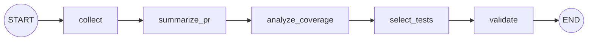

# PBI-002: LangGraph execution and recovery

## Delivery scope

The repository now uses LangGraph for the existing sequential analysis. The HTTP
service persists graph checkpoints in SQLite on its existing data volume. This item
does not change model prompts, model response schemas, or the final `AgentResult`
contract. Deployment into the existing Agent container and live LLM validation are
outside this item's scope.

## Definitions

| Term | Definition in this project |
| --- | --- |
| Job | One queue record identified by the SHA-256 of the existing `BuildRequest` fields. Repeated submission retrieves that record. |
| Generation | Identifier for a fresh analysis run within a job, starting at 0. Restart increments it; resumed attempts keep it. |
| Thread | LangGraph persistence identity: `<job id>:<generation>`. |
| Checkpoint | Graph state saved at a super-step boundary. It is unrelated to the `(checkpoint PBI-...)` label in Git commit messages. |
| Resume | Continue the same generation using its saved state. A generation with no initial checkpoint starts at collection. |
| Restart | Start a new generation from collection, without loading the previous generation's results. |
| Completed node | A node whose output has been durably saved. A provider accepting a request does not, by itself, make the node completed. |

LangGraph defines threads and super-step checkpoints and supports synchronous
checkpoint writes. This implementation uses those APIs with a SQLite saver for the
current single-worker deployment. The official documentation positions SQLite for
local workflows; this is not a distributed storage design.
[LangGraph checkpointers](https://docs.langchain.com/oss/python/langgraph/checkpointers).

## Graph and component ownership



| Component | Responsibility |
| --- | --- |
| `workflow.py` | Build the graph; check a persisted execution manifest; invoke a new graph or resume with `None`; return `AgentResult`. |
| `models/state.py` | Define the JSON-compatible graph state. |
| `nodes/workflow.py` | Adapt existing collection/model operations to state updates. |
| `nodes/pr.py`, `coverage.py`, `existing_tests.py` | Existing model input preparation and response mapping. |
| `lib/parsers/state.py` | Rehydrate plain persisted data as analysis dataclasses; sanitize invalid-state errors. |
| `lib/rules/build.py` | Require collected PR/coverage/trace evidence to match the submitted build. |
| `repositories/checkpoints.py` | Own the SQLite saver connection lifetime. |
| `repositories/sqlite.py` | Own job status, queue limits, generations, migration and atomic transitions. |
| `server.py` | Open the saver for a claimed job and bind its generation/mode to the graph invocation. |
| `bootstrap.py` | Construct dependencies and calculate the configuration/prompt fingerprint. |
| `worker.py` | Acquire the single-worker lock, requeue interrupted jobs, process the queue. |

There is no new feature folder or separate library distribution. Workflow orchestration
now depends on LangGraph; data models and deterministic rules remain framework-independent.
`AnalysisJobs` receives an `AnalysisJob` in its execution callback so the service can
use its generation and mode. The optional `create_app(analyze=...)` testing seam still
passes a `BuildRequest` to its injected callable.

## Persistent state and connection lifetime

`service.data_directory` already defaults to `/data` and is mounted as `analysis-data`:

```text
/data/
  jobs.sqlite3          job identities, status, latest result, generation and mode
  checkpoints.sqlite3   LangGraph state and pending writes for each thread
  worker.lock           existing exclusive worker lock
```

The service opens one saver per claimed execution and closes it before storing the
job's terminal status. `graph.invoke(..., durability="sync")` waits for checkpoint
writes before proceeding to the next graph step. State contains collected evidence
and node outputs, not settings or clients. Persisted data uses plain values rather
than pickled application classes. Artifact formats and the final HTTP result remain unchanged.

Collection is one node. A crash during collection can repeat that collection. The
three model operations are separate nodes. An operation's unchanged internal skip
rules still apply: e.g. no coverage candidates means no coverage model request.

## Recovery and failure behavior

- A worker startup changes leftover `running` jobs to `queued` with `execution_mode=resume`, keeping their generation. The volume lock must be acquired first.
- Existing `queued` jobs continue. Ordinary `failed` jobs remain failed until the operator retries or restarts them.
- An incompatible checkpoint leaves the job failed with `IncompatibleCheckpointError`; it is not erased or silently restarted.
- If the graph completed but the job result was not saved, resume can retrieve the graph's saved result without new model calls, subject to the compatibility/head checks below.
- There is no automatic loop for model errors. The existing provider's own SDK behavior is unchanged.
- A process failure after a provider accepted a request but before its output was persisted can repeat that request. No exactly-once model-call guarantee is made.

Node errors in persistent execution are converted to `AnalysisNodeError` containing
only the original exception class name before LangGraph can persist them. HTTP exposes
the error class rather than remote response text. Evidence and model outputs may
contain private code; checkpoint storage has the same trust requirements as job results.
No credential settings are passed into graph state or graph metadata.

## Compatibility rules

The saved manifest contains:

- workflow contract version (`WORKFLOW_VERSION`);
- configuration/prompt fingerprint;
- PR/MR number and submitted build identity.

The fingerprint covers model provider/name/options, collection limits, code-host and
Jenkins endpoint settings, and the three full prompts. Only the digest is saved.
Named API-key/token fields are excluded so credential rotation alone permits resume.
Provider options are hashed as configured, so changing an option requires restart.

On resume, the manifest is checked before graph state decoding and model operations.
When collected context exists, its build binding is rechecked and the current PR head
is fetched; a changed head rejects continuation. Saved coverage/trace bytes are not
re-downloaded on resume; their previously verified evidence is reused. A new PR head
requires a corresponding new Jenkins build, not an attempt to restart old-build evidence.

Maintainers must bump `WORKFLOW_VERSION` for incompatible topology, state-shape or
node-semantic changes. Automatic migration of incompatible graph checkpoints is not
implemented. A deliberate restart gets a new thread under the current configuration.

Direct library construction with a saver requires a nonempty, caller-managed
configuration fingerprint; `build_agent()` computes it. Direct calls without a saver
execute the same graph without persistence. `resume=True` without a saver is rejected.

## HTTP controls

All paths below are behind the existing `/test-agent` prefix and Bearer authentication.

| Operation | Behavior |
| --- | --- |
| `POST /analyses` | Enqueue a new build identity, or return its existing job. A repeated delivery never increments generation. |
| `POST /analyses/{id}/retry` | If failed, queue the same generation with mode `resume`. Queued/running/succeeded jobs remain unchanged. Returns 202 for an existing job, as before. |
| `POST /analyses/{id}/restart` | For failed/succeeded jobs, increment generation, clear the latest result/error, and queue with mode `new`. Active jobs return 409. |
| `GET /analyses/{id}` | Existing status fields plus `generation`, `execution_mode`, and `thread_id`. |
| `GET /analyses/{id}/result` | Existing result contract; available only for a succeeded job. |

Missing jobs return 404; queue capacity failures return 503. Retry and restart are
atomic database transitions. Restart is an explicit execution command, not a build
submission: issuing it again after the restarted job has finished creates another
generation. Prior checkpoints remain stored but are not exposed as historical results
by the current result endpoint. No checkpoint retention/pruning policy is added here.

The schema migration adds generation/mode columns with defaults for legacy records.
Existing successful results and build deduplication IDs are preserved. Old queued or
interrupted work has no graph progress to reuse and therefore starts collection when
first executed by this version. Back up both databases together when backing up the
service volume. This item does not claim compatibility with running the old application
against the migrated job schema.

## Acceptance evidence

The tests use synthetic source evidence and fake models. They exercise the installed
LangGraph and SQLite saver, not a replacement graph implementation.

| Criterion | Evidence |
| --- | --- |
| AC1: graph and unchanged analysis contract | `test_agent`, `test_analysis_baseline.test_graph_preserves_original_model_messages_schemas_and_results` |
| AC2–AC3: persistent progress and explicit resume | `test_workflow_recovery.test_reopen_resumes_saved_model_outputs_and_keeps_result_contract` |
| AC4: interrupted worker recovery | `test_workflow_recovery.test_process_death_and_worker_startup_recover_from_disk`: terminate the first process with exit 17 inside the third model node, then start a second process using the same files |
| AC5: retry/restart and deduplication | `test_execution_controls`: HTTP retry after reopening the app; fresh generation; active restart conflict; capacity checks; unchanged repeated submission |
| AC6: compatibility and build/head checks | `test_workflow_recovery` rejection cases; `test_execution_controls.test_fingerprint_changes_with_prompts_model_and_collection_but_not_credentials`; existing build mismatch tests |
| AC7: migration and completed graph recovery | `test_execution_controls.test_old_database_migrates_without_losing_successful_result`; `test_workflow_recovery.test_completed_graph_result_can_be_recovered_without_model_calls` |
| AC8: sanitized stored errors and credential exclusion | `test_workflow_recovery.test_provider_error_text_not_persisted`; checkpoint byte checks in the HTTP integration test |
| AC9: full checks, packaging and live collection | 66 tests pass; PR #31 remote smoke exits 0; wheel build and all 69 packaged Python file/import checks pass; Ruff and diff checks pass |

Verification limits: process death/reopen is tested on persistent local files; the
existing Agent container is not redeployed or physically restarted as part of this
item. No real model is invoked, so this evidence does not assess model prose quality.


### Verification run: 2026-10-09

- `UV_CACHE_DIR=/tmp/uv-cache ./scripts/test.sh`: 66 tests passed.
- `uv run --locked ruff check src tests scripts`: passed; separate F821 check also passed.
- `uv build --wheel --offline`: passed using the available build dependency cache.
- Wheel verification: all 69 packaged Python files matched source bytes and imported from the wheel.
- `./scripts/smoke-test.sh 31`: exit 0; 3 changed files, 212 coverage files, 1 retrieved test,
  22 uncovered lines, 7 focal methods and 4 test declarations; no unmatched paths or unassigned lines.
  `trace_fetch` reported 3 tests with `complete=False` (WARN); trace and coverage binding passed.
- Local logs: `.state/verification/pbi-002/` (ignored by Git).

Run the offline automated suite again with `./scripts/test.sh`. The remote smoke command
requires the operator's configured services and credentials; it does not invoke a model.
